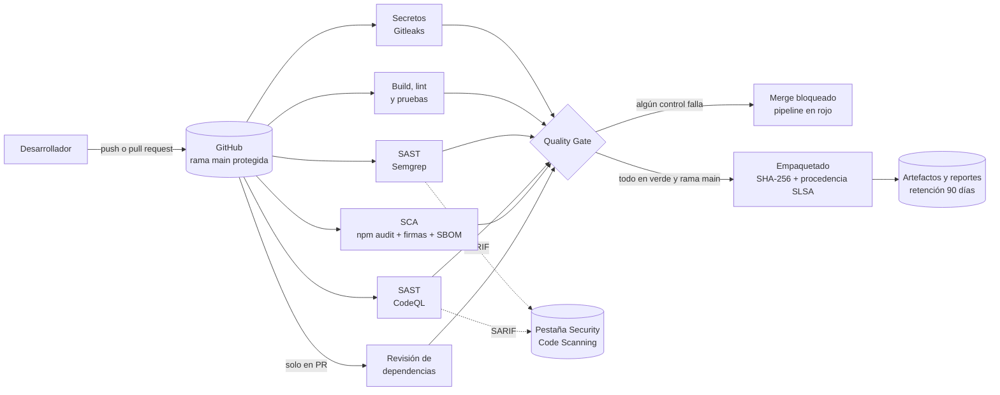

# Arquitectura del flujo de CI

## Etapas, controles y evidencias

| Etapa | Herramienta | Umbral que detiene el pipeline | Evidencia que guarda | Norma |
|---|---|---|---|---|
| Secretos | Gitleaks 8.30.1 (binario verificado por SHA-256) | Cualquier secreto en el historial | `reporte-secretos` (SARIF) | PCI-DSS 6.3, 8.6 · SSDF PO.5 |
| Build y pruebas | `npm ci`, ESLint + eslint-plugin-security, Jest | 1 advertencia de lint · cobertura < 80 % · 1 prueba fallida | `reporte-cobertura` (lcov, cobertura) | SSDF PW.7, PW.8 |
| SAST | Semgrep (reglas JavaScript, nodejsscan, OWASP Top 10) | 1 hallazgo de severidad ERROR | `reporte-sast-semgrep` (JSON, SARIF) | SSDF PW.5, PW.7 · PCI-DSS 6.2.3, 6.2.4 |
| SAST | CodeQL `security-extended` | 1 hallazgo con security-severity ≥ 7.0 | `reporte-sast-codeql` (SARIF) | SSDF PW.5, PW.7 · PCI-DSS 6.2.3, 6.2.4 |
| SCA | `npm audit`, `npm audit signatures`, `npm sbom` | 1 vulnerabilidad High o Critical · firma inválida | `reporte-sca` (JSON, SBOM CycloneDX) | SSDF PW.4 · PCI-DSS 6.3.2, 6.3.3 |
| Revisión de dependencias | dependency-review-action | Un PR que agrega una dependencia High o Critical | Resumen del PR | SSDF PW.4 |
| Quality Gate | Job que evalúa a todos los anteriores | Cualquier control distinto de *success* | Resumen de la ejecución | PCI-DSS 6.3 · SSDF PW.9 |
| Empaquetado | `npm pack`, `sha256sum`, attest-build-provenance | Solo corre si el Quality Gate pasó | Paquete `.tgz`, `SHA256SUMS.txt`, `build-info.json`, atestación firmada | SSDF PS.2, PS.3 |
